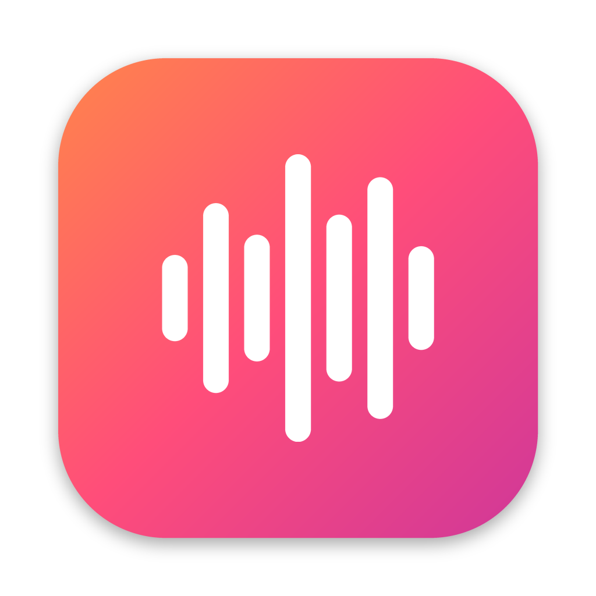

<p align="center">
  
</p>

<h1 align="center">Hello</h1>

<p align="center">
  <strong>Free, private voice dictation and meeting notes for the Mac.</strong><br />
  Everything runs on your Mac. No accounts, no cloud, no API keys.
</p>

---

Hello turns your voice into text in any app. Hold a shortcut, speak, let go, and the text
appears where your cursor is. It also takes notes during meetings, tells speakers apart, and
understands **Bangla and English, even when you switch languages mid-sentence**.

Hello is a native macOS app written in Rust. Speech recognition runs on your Mac's GPU with
Metal, so dictation is fast and works offline.

> **Status:** version 1.0.1. Apple silicon Macs, macOS 15 or newer.
> Download it from [hello.minutecampus.com](https://hello.minutecampus.com).

## Contents

- [Features](#features)
- [Privacy](#privacy)
- [Requirements](#requirements)
- [Getting started](#getting-started)
- [Using Hello](#using-hello)
- [Speech models](#speech-models)
- [Building from source](#building-from-source)
- [Project layout](#project-layout)
- [Troubleshooting](#troubleshooting)
- [License](#license)

## Features

### Dictation
- **Hold to talk:** hold the shortcut (Option by default), speak, and release. The text is
  pasted into the app you're using.
- **Hands-free lock:** double-tap the shortcut to keep recording without holding it.
- **Paste last:** paste the previous dictation again with its own shortcut.
- **On-device models:** choose from several speech models. Each one is downloaded once and
  runs locally.
- **History:** dictations are kept on your Mac (with a retention setting), searchable and
  copyable.

### Smart editing
Cleans up speech as you dictate. Each rule can be turned on or off:
- Removes filler words ("um", "uh", "you know").
- "**scratch that**" deletes the previous phrase.
- "**new line**" and "**new paragraph**" insert breaks.
- "**number one … number two …**" becomes a numbered list.

### Bangla + English
- Speak Bangla, English, or both. Hello listens to each 1.5–3 second piece of a recording,
  detects its language, and sends it to the right model: an English model for English and a
  Bangla model for Bangla.
- **Switch mid-sentence:** English sentences with Bangla phrases (and the reverse) are put
  back together in order. Bangla words inside an English stretch are found with word timings
  and the macOS spell checker, then transcribed again in Bangla.
- Choose **Auto-detect**, **English** or **Bangla** at any time.
- **Help tune Bangla** (optional, off by default) saves your recordings on your Mac so language
  detection can be tuned to your voice.

### Notetaker (meetings)
- Detects calls in Zoom, Google Meet, Microsoft Teams, Webex, FaceTime, Slack huddles and
  browser tabs. Records and transcribes them live, on your Mac.
- **Where and what:** platform, app, browser profile, signed-in account, meeting code and link.
- **Calendar (optional):** matches the call to the event on your calendar, with its title,
  organizer and attendees.
- **Who spoke:** separates speakers with an on-device voice model (28 MB). Name a speaker
  once and Hello recognizes that voice in later meetings.
- Transcript, Overview, Notes and Summary tabs. Copy as Markdown, or move a meeting to the
  Trash.

### Modes
Per-app and per-website behaviour: word replacements and text transformations that apply only
in the apps and sites you choose (for example, different spellings in Slack and in your code
editor).

### Voice Commands (optional, off by default)
Say commands such as "open Safari". Uses a small local model. You can write your own commands
in TypeScript; they run with [Bun](https://bun.sh).

### Personal touches
- **Profile:** words dictated, speaking speed, time saved compared with typing, streaks, a
  14-day chart, and the apps you dictate in most.
- **Appearance:** five recording indicator styles (Classic, Wave, Orb, Line, Dots), each with
  a live preview, placed at the top or bottom of the screen. The menu bar and Dock icons can be
  shown or hidden.
- **Sounds:** start and stop sounds with several themes and a volume setting.

## Privacy

- Audio is recorded and transcribed **on your Mac**. Nothing is uploaded.
- Hello has **no accounts, telemetry, analytics or AI service integrations**. The only network
  use is downloading the speech models you choose and checking
  `hello.minutecampus.com/appcast.xml` once a day for updates.
- Settings, history, models and meeting notes live in
  `~/Library/Application Support/voice-control`.
- Calendar access, speaker recognition and Help tune Bangla are opt-in.

## Requirements

- A Mac with Apple silicon (M1 or newer) on **macOS 15 Sequoia** or newer.
- About 1–2 GB of free space for speech models. Bangla adds about 900 MB.
- Permissions, granted during setup:
  - **Microphone:** to hear you.
  - **Input Monitoring:** to notice the shortcut in any app.
  - **Accessibility:** to paste text into the app you're using and read meeting window titles.
  - **Calendars** (optional): for Notetaker's calendar matching.

## Getting started

Download **Hello.dmg** from [hello.minutecampus.com](https://hello.minutecampus.com), open it
and drag Hello into Applications (or build it from source, below). Then:

1. Open **Hello** from Applications. The first time, macOS can't verify the app: open
   **System Settings → Privacy & Security** and click **Open Anyway** next to Hello.
2. Follow setup: grant the permissions and download a speech model.
3. Click into any text field, hold **Option**, speak, and release.
4. For Bangla: open **Dictation → Languages**, turn on **Bangla + English**, then add the
   Bangla model and the language detector.

### Updates
Hello checks for updates once a day and installs them with one click, then restarts. Check by
hand from the menu bar icon → **Check for Updates…**, or Settings → General.

## Using Hello

| Where | What you can do |
|-------|-----------------|
| **Profile** | Your dictation stats, streaks and top apps |
| **General** | Open at login, menu bar and Dock icons, about |
| **Dictation** | Speech model, microphone, shortcuts, recording behaviour, smart editing, languages |
| **Appearance** | Recording indicator style and position |
| **Sounds** | Sound theme and volume |
| **Modes** | Per-app replacements and transformations |
| **Commands** | Voice Commands (optional) |
| **Notetaker** | Meeting detection, calendar, speaker recognition, and all meeting notes |
| **History** | Past dictations |

Keyboard: ⌘0 opens Profile, ⌘1–⌘8 open the sidebar items in order, and ⌘, opens General.

## Speech models

| Model | Used for | Size |
|-------|----------|------|
| Parakeet English 0.6B (Q8) | Main English dictation, with word timings | ~730 MB |
| Whisper large-v3-turbo (Q8) | Many languages | ~886 MB |
| Whisper large-v3-turbo Bangla (Q8) | Bangla | ~886 MB |
| Whisper base (Q8) | Language detection only | ~85 MB |
| CAM++ speaker model | Telling meeting speakers apart | 28 MB |
| Moonshine | Voice Commands | small |

Models are downloaded from inside the app and stored in
`~/Library/Application Support/voice-control/models`.

The Bangla model is hosted at
[huggingface.co/dhruba-datta/hello-bangla](https://huggingface.co/dhruba-datta/hello-bangla).

## Building from source

### Prerequisites
- Xcode (the full app, for the Metal toolchain and Swift runtime) and `cmake`.
- Rust stable (`rustup`) and Node.js 22.6 or newer.
- An existing `Hello.app` to take the runtime frameworks (ONNX Runtime, Moonshine and Sparkle)
  from. Set `SOURCE_APP` if it isn't in `/Applications`.

### Build and test
```sh
export DEVELOPER_DIR=/Applications/Xcode.app/Contents/Developer
export MACOSX_DEPLOYMENT_TARGET=15.0
node sdk/commands/build.mjs        # builds the Voice Commands kit used by the tests
cargo build --release
cargo test --release
```

### Sign
macOS keeps permissions only for apps with a stable signature. Create a local signing
certificate once; it stays in your login keychain:
```sh
./setup-signing.sh
```
`package-hello.sh` uses the "Hello Local Signing" certificate automatically. Set
`SIGN_IDENTITY` to use a different one.

### Package and install
```sh
./package-hello.sh /tmp/hello-build        # makes /tmp/hello-build/Hello.app, signed
osascript -e 'quit app "Hello"'
mv /Applications/Hello.app ~/.Trash/
ditto /tmp/hello-build/Hello.app /Applications/Hello.app
open /Applications/Hello.app
```

### Release
Updates are signed with an Ed25519 key (its public half is `SUPublicEDKey` in
`app/Info.plist`). With the version bumped in `app/Info.plist` and `APP_VERSION`:
```sh
SPARKLE_KEY=<private key .pem> SIGN_IDENTITY="Hello Local Signing" \
  RELEASE_NOTES=notes.txt ./release-hello.sh /tmp/hello-release
gh release create v<version> /tmp/hello-release/Hello.dmg --repo dhruba-datta/hello-releases
```
Then publish `/tmp/hello-release/appcast.xml` as `hello.minutecampus.com/appcast.xml`.

## Project layout

```text
src/                      Rust source (one crate, binary "voice-control")
  app_window.rs           Main window and every settings pane
  dictation*.rs           Recording, the indicator (with its Metal shader), dictation pipeline
  recognition.rs          Shortcuts and the dictation listener
  parakeet.rs             Model runtime, language routing, Bangla + English mixing
  transcription*.rs       Model catalog, downloads and transcription service
  smart_editing.rs        Filler removal, "scratch that", lists, line breaks
  meeting*.rs             Notetaker: detection, recording, transcripts
  meeting_context.rs      Where a meeting is (platform, app, profile, link)
  calendar.rs             Calendar matching
  speakers.rs             On-device speaker separation and recognition
  language_samples.rs     Optional "Help tune Bangla" recordings
  history.rs              History and Profile statistics
  commands.rs             Voice Commands
app/                      Info.plist and entitlements
native/                   Permission guide (Objective-C)
resources/                Sounds
branding/                 App icon and the script that draws it
sdk/commands/             TypeScript kit for custom Voice Commands
scripts/                  Developer setup scripts
package-hello.sh          Builds and signs Hello.app
release-hello.sh          Makes Hello.dmg and the update appcast
setup-signing.sh          Creates the local signing certificate
```

## Troubleshooting

- **The shortcut does nothing:** check System Settings → Privacy & Security → Input Monitoring
  and Accessibility. After rebuilding, sign with the same certificate, or macOS forgets the
  permission.
- **Hello is missing from Spotlight after reinstalling:** old copies in the Trash can confuse
  Launch Services. Empty the Trash, or run `lsregister -u <old copy>` and
  `lsregister -f -R /Applications/Hello.app` (`lsregister` is in
  `/System/Library/Frameworks/CoreServices.framework/Frameworks/LaunchServices.framework/Support/`).
- **Logs:** `~/Library/Application Support/voice-control/logs/process.log`.

## License

Hello is released under the [MIT License](LICENSE). Third-party components and their licenses
are listed in [THIRD_PARTY_NOTICES.md](THIRD_PARTY_NOTICES.md).
